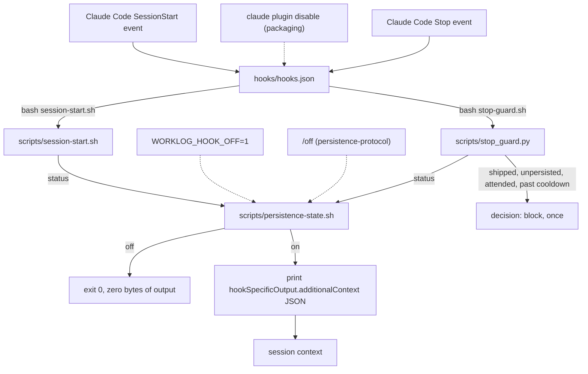

# session-hook

The SessionStart hook that reminds a fresh session of the Outline durable-memory
rule, and the off switch that gates it. Read [`../CONVENTIONS.md`](../CONVENTIONS.md)
before changing anything here, and [`../README.md`](../README.md) for how this
block fits the rest of the plugin.

## What this block is

Five files make the classic hooks. `hooks/hooks.json` wires the plugin into Claude Code's `SessionStart`
and `Stop` events `[verified]`. `scripts/session-start.sh` is the SessionStart
command; it prints one line of JSON carrying the reminder text, or nothing at all
`[verified]`. `scripts/stop-guard.sh` is the Stop command, a thin wrapper around
`scripts/stop_guard.py`: when a commit, push, PR, release or deploy happened
since the last Outline write, it blocks the stop once and asks for a checkpoint, handoff or completion.
It stays quiet in unattended sessions and for a cooldown after each block or
write `[verified]`. `scripts/persistence-state.sh` owns the single on/off marker file
that silences both hooks `[verified]`.

It also holds the native worklog panel: a Mods hooks module
(`hooks/register.tsx`, helpers in `hooks/worklog-panel.ts`, state contract in
`types/index.d.ts`) that `hooks/hooks.json::"modules"` names beside the classic
hooks. It draws a pane for the current project, reads Outline through the
session's connected MCP server, read-only, and runs lifecycle actions through
this plugin's own slash commands
`[verified: uncommitted worktree, not at the pin]`. The panel needs a Claude Code
build with Mods and the module loaded. The `hooks` key of `hooks/hooks.json` and
the lifecycle `commands/` files are unchanged by the panel
`[verified: uncommitted worktree, not at the pin]`; whether a build without Mods
loads the plugin with the new `modules` key has not been run, see
[GAPS](GAPS.md#native-panel-what-is-not-proven). Its contracts are
under [Native worklog panel](CONTRACTS.md#native-worklog-panel).

`[verified: uncommitted worktree, not at the pin]` marks a claim read from files
that are new or changed in the working tree and not yet in any commit. Re-check
and retag those when the change is committed and the docs are re-pinned.

The classic hooks never call Outline and never call an MCP tool. It only emits static
text that names the MCP server `[verified]`; resolving which tool prefix actually
answers to that name is the job of the skill in
[`persistence-protocol`](../persistence-protocol/README.md), which explicitly
warns against relying on one prefix, spelling out the plugin-scoped alternative
(`skills/worklog-persist/SKILL.md::"mcp__plugin_worklog-persist_outline__*"`)
`[verified]`.

## Boundary

This block does not own:

- the skill or the eight slash commands, including `/off`, which only wraps the
  script this block owns (`persistence-protocol`, one sentence and a link, per
  `../CONVENTIONS.md`)
- the plugin manifest, the marketplace entry, `.mcp.json`, or `install.sh`,
  including the structural check that this block's two scripts exist on disk
  (`packaging`, see [`../packaging/CONTRACTS.md`](../packaging/CONTRACTS.md))
- the test suites that exercise this block's files
  (`verification`, see [`../verification/README.md`](../verification/README.md))

## File inventory

| Path | Role |
|---|---|
| `hooks/hooks.json` | Registers `scripts/session-start.sh` against the `SessionStart` event `[verified]` |
| `scripts/session-start.sh` | Reads the off state, then emits `hookSpecificOutput.additionalContext` JSON or nothing `[verified]` |
| `scripts/persistence-state.sh` | Resolves the state directory, and implements `path`, `status`, `off`, `on` `[verified]` |
| `scripts/stop-guard.sh` | Stop hook wrapper; always exits `0` `[verified]` |
| `scripts/stop_guard.py` | Reads the transcript, decides whether to block, keeps a per-session marker `[verified]` |
| `hooks/register.tsx` | Native panel: entry points, refresh, preview, Load, actions, the pane `[verified: uncommitted worktree, not at the pin]` |
| `hooks/worklog-panel.ts` | Native panel: Outline result decoders, project scope, record sections, Load framing `[verified: uncommitted worktree, not at the pin]` |
| `hooks/outline-result.ts` | Native MCP reads, including bounded recovery of host-saved responses from this session's tool-results directory `[verified: uncommitted worktree, not at the pin]` |
| `types/index.d.ts` | Native panel: the `worklog-persist.panel` state contract `[verified: uncommitted worktree, not at the pin]` |

## Why it depends on packaging and persistence-protocol

`${CLAUDE_PLUGIN_ROOT}` in `hooks/hooks.json::"${CLAUDE_PLUGIN_ROOT}"` is an
environment variable the plugin loader supplies, not something this block
defines `[inferred]`, and `install.sh::check_structure()` fails the whole install
if `scripts/session-start.sh` or `scripts/persistence-state.sh` is missing
`[verified]`; that ties this block to `packaging`. The `/off` command
(`commands/off.md`) and the skill both shell out to
`scripts/persistence-state.sh`, and the reminder text names the `outline` MCP
server whose prefix resolution belongs to the skill; that ties this block to
`persistence-protocol` `[verified]`. The native panel runs that block's resolver
(`scripts/resolve-context.sh`) for identity and its slash commands for every
lifecycle action, and opens from `commands/show.md`
`[verified: uncommitted worktree, not at the pin]`.

## Flow

The two dotted paths cross out of this block: the env var is set by whoever runs
the session, `/off` is a persistence-protocol command, and disabling the whole
plugin is a packaging-level action that removes the hook registration entirely
rather than toggling the marker file `[verified]`.
