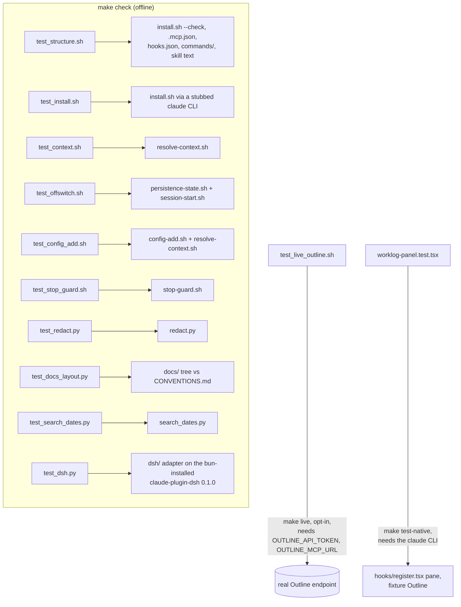

# verification

The test suites for `worklog-persist`, what each one proves, and what nothing in
this repo proves. Read [`../CONVENTIONS.md`](../CONVENTIONS.md) before you write
here.

This block owns `tests/` only. It does not own `install.sh`, the `Makefile`, or
any script under `scripts/`; those belong to
[`packaging/`](../packaging/README.md), [`session-hook/`](../session-hook/README.md)
and [`persistence-protocol/`](../persistence-protocol/README.md). This page cites
the `Makefile` targets that run the suites, because that is the entry point a
reader needs, but the installer and registration targets are documented in
`packaging/`. [inferred]

---

## What this block is

Eleven suites, ten of them offline. Six are plain shell scripts run with `bash`,
not collected by `pytest`: `Makefile::"Not collected by pytest"` is the comment
that explains why `make test` alone would miss them. [verified] Four are `pytest`
modules: `tests/test_redact.py`, `tests/test_docs_layout.py`, `tests/test_dsh.py`
and `tests/test_search_dates.py` (offline subprocess tests of the date
helper: calendar and rolling windows, DST, host upper bound, invalid input; no
Outline retrieval or conversation storage) [verified at the working tree]. The
eleventh, `tests/test_live_outline.sh`, is opt-in and makes its network call only when
`WORKLOG_PERSIST_LIVE=1`; `Makefile::test-sh` still runs it through the
`tests/*.sh` loop, where it prints `SKIP:` and exits 0 [verified].

A twelfth suite, `tests/worklog-panel.test.tsx`, runs under `claude plugin test`
through `Makefile::test-native`, not through `make check`, because it needs the
`claude` CLI. It drives the native panel's hooks and pane on the terminal and
desktop surfaces with fixtures for Outline, processes and commands [verified].

`tests/test_docs_layout.py` is the suite that checks this very `docs/` tree
against the rules in [`../CONVENTIONS.md`](../CONVENTIONS.md), including the file
you are reading. [verified]

`tests/test_dsh.py` copies the plugin to a temp dir without `node_modules`, runs
`bun install --frozen-lockfile` in its `dsh/`, checks that `claude-plugin-dsh`
resolves from that install at version `0.1.0`, and decodes the skill body, the eight
`/wl-` command bodies and the hook events the adapter registers. [verified]
`tests/test_dsh.py::test_check_rejects_an_adapter_without_its_dependency()` is its
negative control. [verified] It needs `bun`, `node` and the npm registry or a warm
Bun cache, and it does not start DSH, so live DSH activation stays untested.
[verified]

---

## How the suites map to entry points

See [`OPERATIONS.md`](OPERATIONS.md) for the exact commands and required tools.

---

## Boundary

This block records what a suite proves and what it does not. It does not restate
the behaviour of `install.sh`, `redact.py`, `resolve-context.sh` or
`session-start.sh` themselves; those facts live in the block that owns that code,
per `docs/CONVENTIONS.md::"Where a fact lives"`. [verified] The suites that
exercise those scripts are still described here, because the suite and its
guarantees are this block's own file. [inferred]

See [`CONTRACTS.md`](CONTRACTS.md), [`INVARIANTS.md`](INVARIANTS.md),
[`GAPS.md`](GAPS.md) and [`OPERATIONS.md`](OPERATIONS.md) for the rest.
